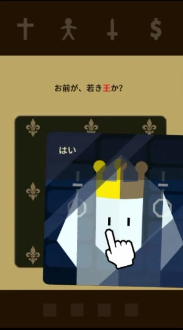
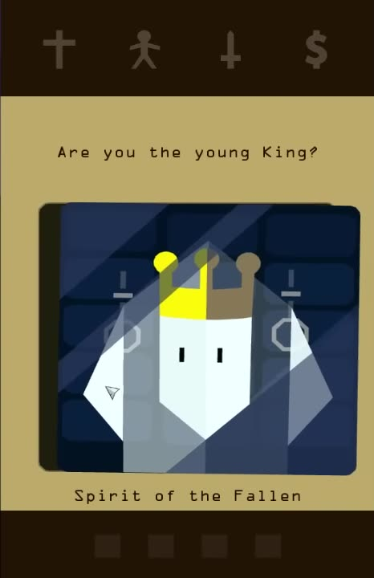
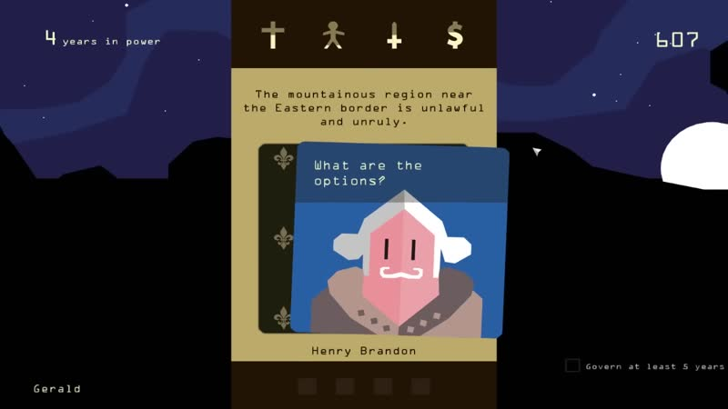
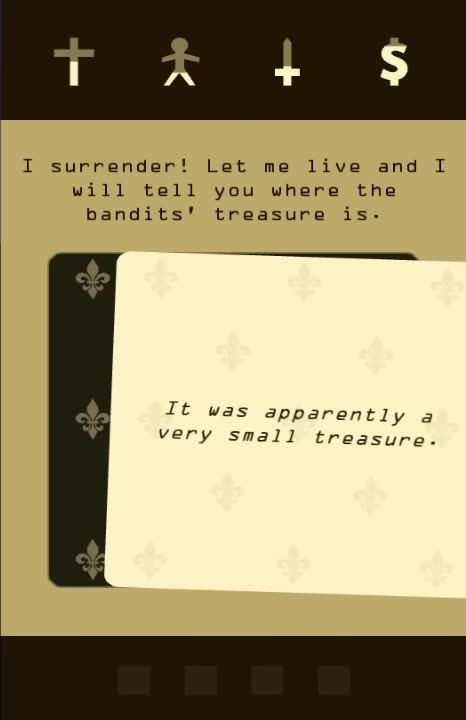
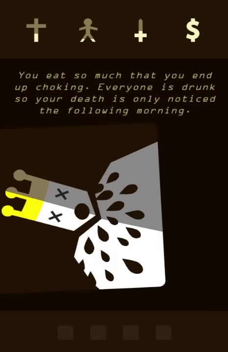
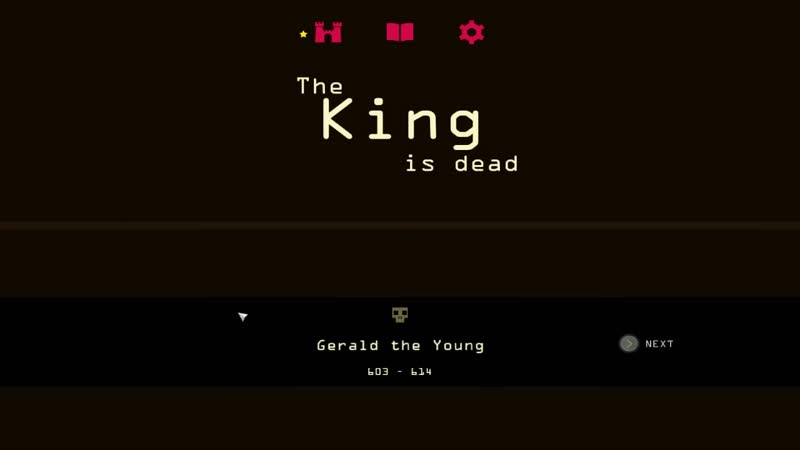
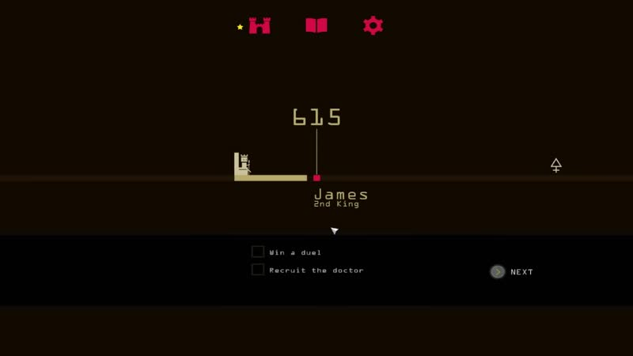
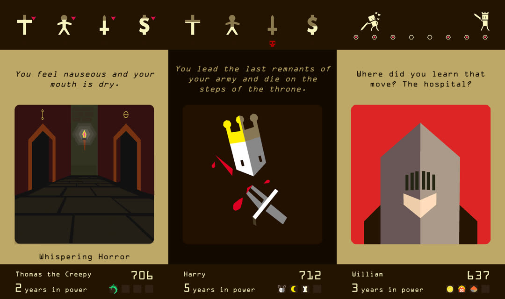

# Reigns: Onboarding, Aesthetic and Pacing

This doc follows `docs/research.md`. That doc covers the systems: meters, the bag, deaths and deeds. This one covers how Reigns *feels* in its first minutes, in enough detail that the Nine Reigns UI and first-run script can copy its beats. Players of Reigns should recognize the jokes.

**Evidence tags** (in addition to research.md's [V]/[S]/[U]):
- **[O]**: observed directly in gameplay frames I extracted and viewed. Timestamps are listed in [Sources](#sources).
- **[O-JP]**: observed in a Japanese-language playthrough. Japanese text was translated by me, not copied from the English game.
- **[I]**: inferred from what was observed, or from general knowledge. Not seen directly.

---

## 0. What I could watch, and how

- **YouTube was blocked.** Watch pages returned a reCAPTCHA or 429. Embeds (`youtube.com` and `youtube-nocookie.com`) returned error 153, or "This content isn't available" when wrapped in a page with a referrer. `yt-dlp` hit "Sign in to confirm you're not a bot".
- **Fallbacks that worked** (downloaded with `yt-dlp` or `curl`; frames extracted with `ffmpeg` and viewed as contact sheets and full-resolution stills):
  1. **Kotaku livestream "Reigns (PC)"**, 18 Aug 2016, mirrored on archive.org (`youtube-6HAZ6BiAlOc`). 17.5 min, 720p, **English**. The save is a few minutes into the first king (Gerald, year 607, "4 years in power"). It includes the **first death → "The King is dead" → 2nd King → Spirit of the Fallen meta-dialogue** sequence in English.
  2. **Niconico `sm30460694`**: a Japanese VOICEROID first playthrough, Reigns ep. 1, Jan 2017. This is a **true first launch from a fresh install**: logos → title → timeline → the tutorial ghost → first death → second and third kings. The UI is in Japanese. I translated the card text.
  3. **Niconico `sm32393916`**: Reigns: Her Majesty ep. 1, a true first launch. Japanese.
  4. Official trailers on Dailymotion (Reigns launch trailer `x4osyku`, plus HM and Apple trailers): 288p, used for layout cross-checks.
  5. **App Store screenshots** (iTunes lookup API, Reigns id 1114127463) for the **mobile portrait layout**. Three of the five downloaded; two failed through the proxy.
  6. The Reigns Fandom wiki (Spirit of the Fallen, Royal Deeds, King names) to confirm English names.
- **Not observed:** audio. I couldn't listen to the footage, and the commentary covers the game audio anyway. The audio section relies on sources. I also had no **English** footage of the very first tutorial cards. I have the Japanese first-launch version and the English second-king version of the same character.

---

## 1. The first 70 seconds, beat by beat

From the fresh-install Niconico run (sm30460694). Timings are from that video, minus its ~6 s intro.

| t (approx) | What happens | Tag |
|---|---|---|
| 0:00 | **Nerial** logo (a white circle mark on near-black), then **Devolver** logo. About 2 s each. | [O] |
| 0:08 | **Title screen**: a tan band holding the four meter icons ✝ 🚶 🗡 $ in black, sitting on the blocky white **REIGNS** wordmark. Below it is a tiny all-caps **status line that changes** ("BUILDING THE CASTLE", "ANTAGONIZING THE DEVIL"), then a ▽ that turns into a ▷ play arrow. **No menu**: one tap starts the game. | [O] |
| 0:16 | **Timeline screen** (the "year" screen): near-black, three small red icons at the top (castle = dynasty, book = collection, gear = settings). A horizontal track has a tiny castle at its left end and a red marker with a vertical line up to the **big year "603"**. Under the marker: **"Gerald" / "0 years in power"**. Bottom strip: **one objective with an empty checkbox, "Govern at least 5 years"**, and a round NEXT button on the right. | [O-JP], English text from [O] Kotaku |
| 0:23 | **Deal**: card backs slide in one after another into a stack (≈3 cards, ~0.15 s apart). The top one flips over. **The meters are dim** (outlined in a muted brown, `#504130`). They aren't "on" yet. | [O-JP] |
| 0:24 | **Tutorial card 1**, *Spirit of the Fallen*: "Are you the young King?" The word **King** is highlighted in red in the prompt. A **pointing-hand icon drags the card left and right on its own**, showing the "Yes"/"No" labels. It appears only on this card and disappears once the player takes over. **[O-JP; I that it's a scripted hint and not the OS cursor, since a different arrow cursor is visible elsewhere in the same video]** | [O-JP] |
| 0:30–0:58 | **Tutorial cards 2–4** (same character, meters still dim). See §2. | [O-JP] |
| 0:58 | **Narration card** (blank cream card, centered italic text): "The ghost stared at the king, then vanished. The king entered the throne room." | [O-JP] |
| 1:02 | **First real card flips in, and the four meters light up at the same moment** (dim brown → cream fill). It's General Bolon on a red card: a threat about a catapult and an arm. From here the player is **alone**: no more hints, no explanation of the dots or meters. | [O-JP] |
| 1:50 | **First deed**: a full-width banner drops across the screen: **"the Young ✓ Govern at least 5 years"**, with yellow stars bursting out. The king's footer name becomes **"Gerald the Young"**. | [O], [O-JP] |
| 2:42 | **First death**, 14 years in (603→617), about **100 s after the first real card**. | [O-JP] |

The Kotaku save showed the same structure in English. The first king, Gerald (603), died after 11 years, at year 614.

**Takeaways for onboarding**
- **Zero menus.** One tap on the title starts the game. The "name + year + objective" screen sits between the title and the deck, and it's the same screen you see between every reign.
- **The tutorial is diegetic and tiny:** 4 dialogue cards from one odd character, then 1 narration card. Reigns never explains the four meters one by one. The ghost says one line about "the four powers in balance", and the meters switch on with the first real card.
- **The swipe is taught by one automated hand-drag on card 1.** That's the only hint. The preview dots are never explained.
- **The player gets a reward within a minute** (the first deed and epithet), and the first death comes inside 3 minutes.

---

## 2. The tutorial and meta-dialogue, as written

### 2a. First-ever reign: Spirit of the Fallen (translated from the Japanese build) [O-JP]

The character is named **"Spirit of the Fallen"** in English ([O] Kotaku; wiki: the ghost of the previous king, whom the player usurped and imprisoned). The portrait looks like **the king seen in a dark mirror**: a white faceless head, a half-gold crown, translucent diagonal glare stripes, and a dark-navy panelled background.

| # | Prompt (my translation) | Left / Right |
|---|---|---|
| 1 | "Are you the young **King**?" | Yes / No |
| 2 | "Then you are the one who usurped my throne and locked me in this dungeon so I could never get out?" | Yes... / No... |
| 3 | "Anyway, from now on you will run everything. Do your best. They're all mad, every one of them." | What are you talking about? / Who are you talking about? |
| 4 | "If you want to live long, keep the four powers in balance and manage them well." | Yes / No |
| — | *Narration:* "The ghost stared at the king, then vanished. The king entered the throne room." | (either swipe) |

The answers make no difference. Each card exists to get one swipe out of the player.

### 2b. Second reign: Spirit of the Fallen again (English, verbatim) [O]

After the first death, the new king gets this exchange (Kotaku 4:28–5:11):

1. "Are you the young King?" — *Yes* / *I'm not sure...*
2. "Ha ha, just kidding. I know we've been through this already. That's our curse, see?" — *I don't understand*
3. "We will remember each and every King of this dynasty. Every compromise, every death for ages..." — *How...* / *But...*
4. "It is said that only the Devil will allow us to blissfully forget the cursed Kings, but does he even exist?" — *Yes he does* / …
5. "That's an interesting thought. Maybe he does. Maybe we will find him eventually."
6. *Narration:* "The spirit slowly drifts away..."

In the Japanese run the same spirit adds "Hmm... perhaps. Someday we may have to face the devil." **The Devil meta-arc is set up on the second king, about 3 minutes in.** By the third king (koto 6:56) the deck opens on an ordinary card (the pigeon). The spirit stops introducing every reign. [O-JP]

### 2c. Her Majesty's variant (secondary) [O-JP]

Opening: Nerial and Devolver logos, then a fake "**Synaptic Insight**" corporate logo (a deadpan setup for the game's "ghost in the machine" meta). Title: "REIGNS / HER MAJESTY" with the meter icons on a red band. The start screen is a **zodiac wheel** with the year (999) and the queen's name in the middle. On first launch it greets you with "Welcome back, Your Majesty!", already a hint at the loop. Then:

1. **The King**: "What a magnificent wedding! How does it feel to be my **queen**?" — *The best*
2. King: "You'll get used to it. My mother did. Countess Lorentina will teach you everything. See you." — *Got it*
3. **Countess Lorentina** (orange card): "Oh, how young our new queen is! Please call me 'Mother'..." — *Huh?* / *No!*
4. Countess: "Of course! Now let me show you the balance a queen must have." — *Balance?* / *Yeah, yeah*
5. Countess: "A queen must be respectful yet flexible, common yet dignified, aggressive yet peaceful, rich yet humble." **The meters light up on this card.** The four "X yet Y" pairs map left to right onto the four icons and teach that each meter fails at both ends. — *Leave it to me!*
6. First real card (≈1:24 from launch): the court official, "At last a new queen! Watch how low I can bow!"

HM is darker: navy-black UI (`≈#0B0B1B`) instead of tan, and **5 rounded item slots** instead of 4 square status slots.

**Lesson:** HM's single sentence that maps "X yet Y" pairs onto the four meters is the clearest meter tutorial in the series. Nine Reigns should borrow that sentence shape and keep Reigns' "weird voice first" opening.

---

## 3. Death and succession, in detail [O]

Kotaku 3:46–4:28 (English), cross-checked against koto 2:42–3:10 and 6:36–6:58.

1. **The fatal card** reads like any other, but the last prompt shows the crisis ("Your country is so rich! We're throwing a party to celebrate with the most expensive food money can buy!"). **Both labels are the same stunned word**, "What...". [O]
2. **Death card.** The tan panel and the night-sky background vanish and the whole board turns **near-black brown `#110800`**. The meters stay at the top. On the mobile build, a **red skull appears under the meter that killed you** ([O] App Store screenshot, `≈#BF0000`). The death illustration (a faceless crowned head, X eyes, a few props) sits on a slightly lighter card, `#210F00`. The **caption is in italic grey `#888888`**: "You eat so much that you end up choking. Everyone is drunk so your death is only noticed the following morning." / "You lead the last remnants of your army and die on the steps of the throne." Deadpan, one or two sentences, often with a punchline. It **waits for a tap or swipe**. The player in the koto run read it for about 8–14 s.
3. **"The King is dead" screen.** The same dark background, with three lines stacked and staggered: "The" (small), "**King**" (large), "is dead" (small, indented), in cream `#F8F2C4`. Below it, a darker band holds a **small skull/tombstone icon**, "**Gerald the Young**", and "**603 - 614**", with NEXT on the right. [O] The epithet appears on the tombstone, so deeds pay off at death.
4. **Timeline screen.** The old king's marker slides along the track while it reads "Gerald / the Young / 11 years in power" (~2 s). Then the marker jumps to the next year: "**615**", "**James / 2nd King**". The Japanese build also flashes "新王が即位!" ("A new king is crowned!") here. Below that are **three new objectives** with empty checkboxes ("Win a duel", "Recruit the doctor", "Meet the devil") and NEXT. [O] After a record reign, a **yellow "★ HIGH SCORE ★" band** shows the reign length. [O-JP]
5. **Deal and flip.** The first card is the Spirit's meta-dialogue (§2b) on reign 2. After that, normal play resumes.

So the death → new reign loop takes **2 taps and roughly 10–20 s**, and **at least one joke lands in every step**: the stunned label, the death caption, the epithet on the tombstone, the ordinal "2nd King".

**Other interstitials [O]:**
- Deed banner: a full-width strip, `#E95E77`, with dark-maroon text `#3C0007`. The epithet goes on top ("the Young") and the deed under it ("Govern at least 5 years"). It has a green check and yellow star particles, sits over the card, and lasts ~3–4 s with a NEXT.
- "**New card discovered!**" banner: the same style, red, naming the new card. [O-JP]

---

## 4. Visual aesthetic spec

### 4a. Palette (sampled from 720p English frames; video compression shifts colors by about ±3)

| Element | Hex | Notes |
|---|---|---|
| Meter bar and footer bar | `#221302` | very dark brown |
| Play panel behind the prompt, card and name | `#BCA665` | tan/parchment-mustard; the dominant color |
| Prompt and name text | `#2A1500` | near-black brown on tan |
| Meter icon, filled part | `#F9EFC4` / `#FDF1C4` | warm cream |
| Meter icon, empty part | `#877752` | olive; the icon is the gauge (see 4c) |
| Meter icon, inactive (tutorial) | `#504130` | whole icon dimmed |
| Meter flash, up | `#00FE09` | pure green, fades to cream |
| Meter flash, down | `#FF000E` | pure red, fades to cream |
| Card back | `#1C1B0C` + motif `#746C4F` | near-black with fleur-de-lis in olive |
| Narration card | `#FDEEC0`, text `#43340C` italic | cream, with a faint tone-on-tone fleur pattern |
| Choice-label band | card color darkened ~35% (blue `#225CA6` → band `#224571`; red `#DC2322` → band `#A11F19`) | label text is light, `#D7E6E8` |
| Character card backgrounds | solid and saturated, one per character: blue `#225CA6`, red `#DC2322`, purple (Archbishop), lime-yellow (dog Rex), green (John), pink-red (Lady), steel blue (pigeon) | the character *is* their color |
| Death and interstitial background | `#110800` | |
| Death caption | `#888888` italic | |
| Deed banner | `#E95E77`, text `#3C0007` | |
| Timeline icons and highlights | red/crimson (`≈#DC1140`) | |
| PC side scenery | night sky `#20214A` / `#232C5C` bands, black silhouettes, white moon | PC only; mobile is the column alone |
| Her Majesty UI | `≈#0B0B1B` navy-black | |

### 4b. Layout (mobile portrait, from App Store screenshots [O]; PC centre column matches [O])

Percentages are of screen height on a 9:16 phone.

| Band | Range | Contents |
|---|---|---|
| Meter bar | 0–17% | 4 large icons, evenly spaced. **Preview dots sit above each icon**, at the top edge of the bar (research.md §8 says "below"; footage shows above). |
| Prompt | ~20–32% | 1–4 centered lines on tan |
| Card | ~35–81% | ~83% of screen width, **square** (1:1). The next card back peeks out underneath. |
| Name | ~84–87% | centered, on tan |
| Footer | ~88–100% | left: "**Name the Epithet**" (small), then "**N** years in power" with a big numeral. Right: **big year digits** above **4 square status slots**. |

PC puts the same column in the middle at ~36% of screen width (466 of 1280 px), with years top-left, year top-right, name bottom-left and objective bottom-right in the side scenery. [O]

### 4c. Meters
- Each meter is **a single flat silhouette icon** (cross, stick-person, sword, dollar sign) that **fills bottom-up** in cream. The unfilled top stays olive. There's no separate bar and no number. [O, zoomed]
- **Preview dot:** a small olive/cream circle centered **above** the icon. It appears once the drag passes a small dead-zone. Two sizes (small and large). No direction. [O]
- **On commit:** affected icons flash solid green or red right away (the next frame after release), hold ~0.3 s, then fade back to cream over ~0.7 s (≈1 s total). [O, 30 fps frame-stepping]
- In the dungeon, small red down-triangles beside the meters show drain. [O, store screenshot]

### 4d. Characters and cards
- **Low-poly, flat, faceless-ish portraits**: a two-tone split face (light and shadow halves), **two vertical tick eyes "| |"**, sometimes a mouth or moustache. Hats and hair are big geometric shapes. The portrait fills the card edge to edge on one saturated color. [O]
- **Expressions change while you drag.** The eyes switch from "| |" to "> <" (wince) when you pull toward one answer. [O, frame-stepped Kotaku 1:48] It's cheap and very charming.
- **Card back:** dark with an olive fleur-de-lis grid. The deck stack shows 1–3 offset backs. [O]
- **Choice label:** while dragging, a **darker band of the card's own color slides into the top ~22% of the card**, holding the label in light text. The label sits **on the side opposite the drag direction** (drag right → label top-left; drag left → label top-right), so the finger never covers it. [O]
- **Card motion (PC):** the card follows the pointer with a small tilt (≈5–10°). On commit it **drops away and leaves the frame in ~0.27 s**. The next card back slides in, and the card **flips around its vertical axis with perspective** (like a door/book page) in **~0.35–0.40 s**. The prompt text **cross-fades** during the flip. [O, frame-stepped Kotaku 1:48–1:52]
- **Narration cards** are cream with centered italic text, and the prompt area above **keeps the previous prompt** (dimmed). Either swipe continues. [O]

### 4e. Typography [O]
- One **monospace-feeling, widely letter-spaced sans** for everything (prompt, labels, names, HUD), in **sentence case**, centered. Narration and death captions use the **italic** of the same face. Big numerals (year, years in power) are in a **squared, segment/LCD-like display style**. The wordmark is blocky all-caps.
- Prompts are short: **1–4 lines of ~28–36 characters** (≈40–150 chars). Labels are **1–4 words**, sentence case, often ending in "!", "?" or "..." ("No pity!", "What are the options?", "I don't care", "Call him back", "What...").
- **Keyword highlight:** the first tutorial prompt colors the key noun red ("Are you the young **King**?"). [O-JP]
- Names are proper names with titles ("Henry Brandon", "General Blomington", "Sir Adémar", "Borhat Loosetongue", "Archbishop of Ostwald"). Character comedy depends on recurring named people.

---

## 5. Audio (not observed; from sources)

- Score by **Disasterpeace** with Mateo Lugo. Reviewers describe it as subtle, sitting under the scene. Soundtrack cue titles are character themes ("Minstrel's Martial Song", "His Majesty's Fool"). [S: GOG, DekuDeals, EndlessMode]
- **Characters "speak" in warbled, Animal Crossing-like gibberish barks** when their card appears. Charming, but called grating after long sessions. [S: EndlessMode; research.md]
- Swipe and flip sounds are not documented in any source I found. [U]
- Implication for us (PRD: sound off by default): if we add sound, use **one short pitched "mrrp"/chirp bark per character** (different pitch per character, ≤300 ms, random 2–3 syllable variant), a **soft paper flick** on flip, and a muted thump on commit. Never loop voice.

---

## 6. Pacing

| Measure | Observed | Tag |
|---|---|---|
| Launch → first real card | ~70 s (incl. ~15 s of logos, 7 s title, 7 s timeline, 35 s tutorial) | [O-JP] |
| Tutorial length | 4 dialogue cards + 1 narration card | [O-JP] |
| Card dwell, first-timer (commentating) | **~6–8 s/card** (Gerald: 14 years in ~100 s; Harry: 6 years in ~50 s). Reigns with more text and banners: ~11 s. | [O-JP] |
| Card dwell, practised player | ~3–4 s [I] | |
| First deed/epithet | 5 swipes (~45 s after the first real card) | [O] |
| First death | 14 swipes (koto), 11 years (Kotaku Gerald), 16 years (koto 2nd king) | [O] |
| Death → next reign playable | 2 taps, ~10–20 s | [O] |
| New faces | In the first 14 real cards: General, Jester, Rex (dog), peasant, nobleman, miners, Lady, Archbishop, John the Bold, Doctor, pigeon. **A new character roughly every 1.5 cards**, with repeats that come back with consequences. | [O-JP] |
| Joke density | Pure-silly cards about every 3rd card: the jester "played tennis with a giant, I lost"; the dog card reads "Woof! Grr! Woof woof!" with labels "Hmm, indeed" / "Sit!"; the pigeon says "Coo!"; the jester's gift asks "Left!" / "Right!". Most other cards have a dry twist in a label. | [O-JP] |
| Meta beat | The Devil is first mentioned on reign 2 (~3:10 into the session) | [O] |

**Implication for Nine Reigns:** the PRD puts Joy's starting value at 35 (closest to its failure point). With Reigns' pacing as the target, the **first loss for a new player should land around swipe 12–25 (~2–3 min)**. That's a full Day 3–6 of our clock, long enough to see 2–3 jokes and one goal banner. Tune the intro run's draws so Joy can't drop more than ~15 in the first 6 cards.

---

## 7. Tongue-in-cheek gags players remember, and cat-world nods

| Reigns thing | Why players remember it | Nine Reigns nod |
|---|---|---|
| **Spirit of the Fallen**, the mirror-ghost "Are you the young King?" | First line of the game, a weird opener | **The Instinct**, seen as the cat's reflection in a dark window: "ARE YOU THE NEW CAT?" (all caps per PRD) |
| "Ha ha, just kidding. I know we've been through this already. That's our curse, see?" | The loop is revealed | Same line, word for word in spirit, for cat #2 |
| **The Devil**: "does he even exist?", arrives around year 666 | Meta-quest | **The Red Dot**: "THEY SAY ONLY THE RED DOT CAN MAKE US FORGET. BUT DOES IT EVEN EXIST?" (it's a laser pointer, and it never gets caught). Optional: its first true appearance on **Night of Day 6 for cat #6** (666). |
| **Year counter 603 →** | A persistent dynasty calendar | Big top digits = **Day N**. The shelter tag carries **intake #603** for cat #1 (and #604…) |
| "**N years in power**" | Score | "**N days on trial**" |
| **"The King is dead"** stacked type + tombstone "Gerald the Young 603–614" | The death card | **"The / Trial / is over"** + shelter-tag icon "Biscuit the Kitten · Day 1 – Day 4" |
| "James · **2nd King**" | Dynasty ordinal | "Pudding · **2nd Cat**" (flavour: "Life 2 of 9", since the title is *Nine Reigns*) |
| Epithets: **the Young** (govern 5 years), the Lover, **the Boyfriend** (date a pigeon), the Creepy (lost in the dungeon), the Greedy | Name changes are rewards | **the Kitten** (reach Day 2), **the Lap Cat** (sleep on owner), **the Birdwatcher** (befriend the window bird), **the Void** (lost under the bed), **the Bottomless** (eat 5 meals), **the Gremlin** (knock 5 things off) |
| **The Pungeon** (dungeon sub-bag, meters drain) | Weird mini-mode | **Under the Bed**: a dark sub-bag where Belly drains and you find hair ties, a lost sock, a 2019 receipt |
| **Memento Mori** death gallery | Collect deaths | **Memento Meowri** endings gallery |
| Title status lines ("BUILDING THE CASTLE", "ANTAGONIZING THE DEVIL") | Tiny deadpan flavour | "KNOCKING THINGS OFF THE LOGO", "ANTAGONIZING THE ROOMBA", "WARMING UP THE LAPTOP", "COUNTING THE KIBBLE" |
| First king is **Gerald** | Some players remember the name | The owner's houseplant is **Gerald (a fern)**. He is crunchy. |
| Rex the dog: "Woof! Grr! Woof woof!" / "Sit!" | Pure silliness | Window bird: "Tweet. Tweet tweet." / labels "Chatter" / "Stare harder" |
| Both labels the same stunned word on the fatal card ("What...") | Doom you can't refuse | "...Meow?" / "...Meow?" |
| Fleur-de-lis card back | Royal identity | **Paw-print or fish-bone** grid on the card back |
| Four icon meters ✝ 🚶 🗡 $ | Iconic silhouettes | ❤️ 🏠 🐾 🐟 as flat single-color silhouettes (no emoji gloss), filling bottom-up |

---

## 8. Proposed Nine Reigns onboarding script

Conventions: `{cat}` is the shelter name, `{owner}` comes from owners.json, and the first-ever run gets a gentle owner (no quirk penalties) and no complications (per PRD). Text stays within the PRD's ≤140 / ≤20 character limits. "Tutorial" cards are `bag: "intro"` with `noTime: true` and zero `fx`, and **the meters stay dim (`#504130`-style) until card 6**.

### 8a. Before the deck

1. **Title.** "NINE REIGNS" wordmark under a tan band holding the four silhouettes ❤️🏠🐾🐟, with one rotating status line under it ("ANTAGONIZING THE ROOMBA"). Tap anywhere to start. No menu.
2. **Trial file** (our timeline screen). A track of 14 notches with a tiny shelter icon at its left end and a paw marker on notch 1. Big digits: "**Day 1**". Under the marker: "**{cat}** / 0 days on trial" and the shelter tag "#603". Bottom strip: **one goal**, ☐ "Make it to Day 2", and NEXT. Also show "{owner} · {home}" (PRD intro card info).
3. **Deal.** Three card backs slide in (150 ms stagger) and the top one flips (380 ms).

### 8b. First ~10 cards, verbatim

| # | Char (name under card) | Prompt | Left | Right | Notes |
|---|---|---|---|---|---|
| 1 | `instinct` (The Instinct) | ARE YOU THE NEW **CAT**? | Yes | No | "CAT" in red. **Auto hand-drag hint** wiggles the card L→R→centre twice; it stops when the user touches. Portrait: the cat's reflection in a dark window with glare stripes. |
| 2 | `instinct` | SO YOU'RE THE ONE WHO LEFT CAGE 9 AND WALKED INTO THE CARRIER. ON PURPOSE. | Yes... | It was a trick | Parallel of "usurped my throne". |
| 3 | `instinct` | ANYWAY. FROM NOW ON YOU RUN THIS HOUSE. GOOD LUCK. THE HUMANS HERE ARE ALL MAD. | What humans? | Mad how? | Parallel of "They're all mad". |
| 4 | `instinct` | IF YOU WANT TO STAY, KEEP ALL FOUR IN BALANCE. TOO LITTLE IS BAD. TOO MUCH IS ALSO BAD. NOT FAIR. | Four what? | Understood | Parallel of "keep the four powers in balance". |
| 5 | `narrator` (narration card) | *The voice goes quiet. The carrier door clicks open. Somewhere, a vacuum cleaner is sleeping.* | — | — | Cream card, italic. The previous prompt stays dimmed above. Foreshadows the Roomba. |
| 6 | `shelter` (Dana, Shelter Volunteer) | Two-week trial! Be loved, don't wreck the place, don't go feral, eat your dinner. That's the whole job. | Sounds easy | Two weeks?! | **Meters light up as this card flips**, staggered left to right (❤️🏠🐾🐟, 120 ms apart), matching the four clauses (the HM "X yet Y" trick). fx: L joy +5 · R instinct +5, so the **first preview dots** appear. Time starts here. |
| 7 | `owner` ({owner}) | Welcome home, {cat}! This is your bed. It was eighty dollars. It has memory foam. | Sniff the bed | Sit in the box | L joy +10, instinct +5 · R instinct −10, joy −5. |
| 8 | `plant` (Gerald, a Fern) | This is Gerald. Gerald is a fern. Nobody has ever chewed Gerald. Gerald looks crunchy. | Respect Gerald | Chew Gerald | L instinct +5 · R instinct −10, home −5, belly +5. Our "first king Gerald" nod. |
| 9 | `owner` | Dinner time! One scoop, exactly like the shelter said. | Eat politely | Yell for scoop 2 | L belly +10 · R belly +15, joy −10. |
| 10 | `instinct` | THE GLASS OF WATER ON THE TABLE. IT IS LOOKING AT US. | Let it live | Knock it off | L instinct +10 · R instinct −15, home −10, joy −5. Sets `knocked +1`. |

Then normal draws. Around swipe 4–8 (Day 2 Morning), show the goal banner: pink strip "**{cat} the Kitten** ✓ Make it to Day 2" with star burst. The footer name becomes "{cat} the Kitten".

### 8c. First-loss transition (example: Joy hits 0)

1. **Forced card** (`owner`): "I... I don't think this is working out. I'm calling the shelter in the morning." — **...Meow?** / **...Meow?**
2. **Ending card**: the board goes `#110800`, meters stay up, and a small red ✕/tag appears under ❤️. Illustration: the cat sitting in the carrier, unimpressed. Grey italic caption: *"You are returned to the shelter in the same carrier. It still smells like the volunteer's tuna sandwich."* Tap to continue.
3. **"The / Trial / is over"** (stacked like "The / King / is dead"), with a shelter-tag icon and "**{cat} the Kitten**", "**Day 1 – Day 4**". NEXT.
4. **Track:** the paw marker slides back to the shelter icon (~1.5 s) while it reads "{cat} the Kitten / 4 days on trial". Then a flash, "**Long live the Cat!**". The new marker appears at "Day 1": "**Pudding** / **2nd Cat**" (subline "Life 2 of 9"), shelter tag "#604", **three goals** (e.g. "Sleep on the owner's face", "Knock 3 things off tables", "Meet the Roomba"). NEXT.

### 8d. New-cat transition (cat #2 only: the meta reveal)

| # | Char | Prompt | Left | Right |
|---|---|---|---|---|
| 1 | `instinct` | ARE YOU THE NEW CAT? | Yes | I'm not sure... |
| 2 | `instinct` | HA. JUST KIDDING. I KNOW WE'VE DONE THIS BEFORE. THAT'S OUR CURSE, SEE? | I don't understand | Curse? |
| 3 | `instinct` | WE REMEMBER EVERY CAT WHO CAME BEFORE. EVERY RETURN. EVERY RUG. FOR NINE LIVES... | How... | But... |
| 4 | `instinct` | THEY SAY ONLY THE RED DOT CAN MAKE US FORGET. BUT DOES THE RED DOT EVEN EXIST? | Yes it does | It's a laser |
| 5 | `instinct` | INTERESTING. MAYBE IT DOES. MAYBE ONE DAY WE WILL CATCH IT. | — | — |
| 6 | `narrator` | *The Instinct slowly curls up somewhere behind your eyes...* | — | — |

Then, as in Reigns, the meters stay lit and normal draws start. Skip the Volunteer card; the trial file screen already gave the goals. From cat #3 on, there's **no intro**: the deck opens on a normal card. Like the Spirit, the Instinct comes back only at meta milestones (the first Red Dot sighting, the first adoption).

---

## 9. Top implementation specs (summary for the UI implementer)

1. **Palette:** bars `#221302`, play panel `#BCA665`, text `#2A1500`, card back `#1C1B0C` with motif `#746C4F`, narration card `#FDEEC0`, death and interstitial background `#110800`, caption `#888888`, banner `#E95E77`. Give each character one saturated solid card color.
2. **Layout (portrait):** meters 0–17%, prompt ~20–32%, square card ~83% of width at ~35–81%, name ~84–87%, footer ~88–100% ("Name the Epithet" + "N days on trial" left, big "Day N" + status slots right). Desktop: the same column, centered.
3. **Meters:** single flat silhouettes filling bottom-up (cream `#F9EFC4` over olive `#877752`). Dim (`#504130`) during the tutorial. Flash `#00FE09`/`#FF000E` on the frame after commit, hold 0.3 s, fade 0.7 s.
4. **Preview dots go ABOVE the icons** (correcting research.md §8). Two sizes, no direction. They appear after a small drag dead-zone.
5. **Drag label:** a darker band of the card's own color slides into the top ~22% of the card, with the label in light text, aligned to the side **opposite** the drag.
6. **Animation:** exit ~270 ms (drop and fly off). Next card slides in, then flips on the Y axis with perspective in ~350–400 ms while the prompt cross-fades. Deal 3 backs with 150 ms stagger at run start. Portrait eyes change ("| |" → "> <") while dragging toward a choice.
7. **Type:** one widely-tracked monospace-like sans (self-hosted, since the PRD bans external calls), sentence case, centered. Italic for narration and endings. Segment-style display digits for Day numbers. Prompts of 1–4 lines (~30 chars/line); labels of 1–4 words. Instinct is ALL CAPS.
8. **Onboarding:** one tap from title to the trial file screen, then NEXT to the deck. 4 Instinct cards + 1 narration + the Volunteer card; meters light on card 6. One automated hand-drag on card 1 is the only hint. Never explain the dots.
9. **Pacing:** design for ~6–8 s per card for new players. First goal banner by swipe ~5, first loss around swipe 12–25. A new face about every 1.5 cards; a pure-silly card about every 3rd.
10. **Loss loop:** fatal card with identical labels → dark ending card (tap) → "The / Trial / is over" + tag + epithet + day range (NEXT) → track slide + "Long live the Cat!" + 3 goals (NEXT) → deal. No more than 2 taps, about 15 s.

---

## Sources

**Footage (downloaded and frame-extracted; contact sheets at 1–4 s steps, per-frame at 30 fps where noted)**
- Kotaku Livestream Archive: *Reigns (PC)*, 18 Aug 2016, archive.org mirror of YouTube `6HAZ6BiAlOc`: https://archive.org/details/youtube-6HAZ6BiAlOc
  - Viewed: 0:00–1:10 (title, status lines, timeline, first cards) every 2 s; 1:10–2:18 every 2 s (Sir Adémar chain, narration card, the Young deed banner); 1:48.5–1:52.4 **every frame** (drag expressions, label side, commit, meter flash, flip timing); 3:46–4:28 every 2 s (death card, "The King is dead", timeline, 2nd King); 4:26–5:35 every 3 s, cropped (Spirit of the Fallen dialogue, English); stills at 0:22, 0:38, 1:38, 1:53, 2:05, 3:56, 4:08, 4:16, 4:29 for color sampling. Dark segments auto-detected at ~233 s, 716 s, 970 s.
- Niconico `sm30460694`: 【Reigns】琴葉王国 この呪われた王様に選択を！01 (fresh install, JP): https://www.nicovideo.jp/watch/sm30460694
  - Viewed: 0:00–1:00 every 2 s; 0:30–3:30 every 2 s, cropped to the column; 0:30.5–0:38.5 at 6 fps (hand hint); 3:30–7:50 every 4 s; full-frame 2:46–3:32 and 6:36–7:46 every 2 s (both deaths and successions).
- Niconico `sm32393916`: 琴葉王国２ Reigns Her Majesty 01 (JP): https://www.nicovideo.jp/watch/sm32393916. Viewed 0:00–2:30 (logos, title, zodiac start, the King and Countess Lorentina tutorial).
- Niconico `sm44091108` (Reigns, 2024, JP): skimmed 0:00–1:00 to cross-check the title, timeline and Spirit cards.
- Dailymotion: *REIGNS – Launch Trailer* https://www.dailymotion.com/video/x4osyku (viewed every 2 s; stills at 0:09, 0:57). Also skimmed: x89nr3y (Apple trailer), x8afea5 (HM launch trailer), x8mrh4j.
- App Store screenshots via iTunes lookup: https://itunes.apple.com/lookup?id=1114127463 (3 of 5 portrait screenshots: dungeon, death card with red skull, duel).

**Text**
- Reigns Fandom wiki: *The Ghost / Spirit of the Fallen* https://reigns.fandom.com/wiki/The_Ghost · *The King* https://reigns.fandom.com/wiki/The_King_(Reigns) · *Royal Deeds* https://reigns.fandom.com/wiki/Royal_Deeds
- EndlessMode, *Reigns Offers Grand Strategy By Way of Tinder* (voices, score): https://www.endlessmode.com/video-games/reigns/reigns-offers-grand-strategy-by-way-of-tinder
- GOG store page (score credit): https://www.gog.com/game/reigns · DekuDeals soundtrack listing: https://www.dekudeals.com/items/reigns-soundtrack
- TechRaptor (5-min gameplay link, not watched since YouTube was blocked): https://techraptor.net/content/reigns-gets-release-date

**Blocked or unavailable:** YouTube watch, embed and nocookie pages, and yt-dlp (bot check); Vimeo (captcha); Bilibili search (412).

**Frames in this doc** (`docs/img/onboarding/`):

